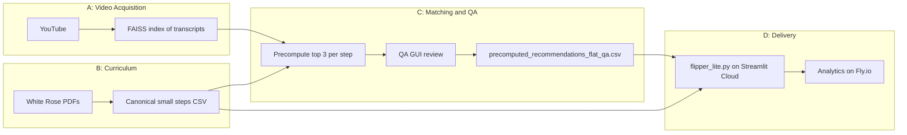

# Flipper

Flipper finds the best maths teaching videos on YouTube for every small step of the
White Rose Maths curriculum (Years 1 to 11, ages 5 to 15) and serves them free at
[flipper.school](https://www.flipper.school).

## Purpose

Teachers, parents and home-schoolers choose a year group, topic and small step and
get three reviewed videos that teach exactly that step. All search and AI scoring is
done offline in advance, so the public app is fast and costs nothing per visit.

## How it works

The project has four modules. Each has a one-page doc with its purpose, scope,
commands, inputs, outputs and key files.

| Module | What it does | Doc |
|---|---|---|
| A. Video Acquisition | Find YouTube videos (channels, IDs, title search), download transcripts with bot-detection avoidance, build the local FAISS search index, delete videos | [docs/acquisition.md](docs/acquisition.md) |
| B. Curriculum | Extract White Rose small-step text from PDFs into one canonical curriculum CSV, and write short descriptions with an LLM | [docs/curriculum.md](docs/curriculum.md) |
| C. Matching and QA | Match videos to each step (semantic search, constraints, LLM alignment and teaching-quality scoring), review by hand, replace removed videos, publish | [docs/quality_assurance.md](docs/quality_assurance.md) |
| D. Delivery | The public Streamlit app (selector, video cards, thought prompts, email-me-these-videos) and analytics | [docs/delivery.md](docs/delivery.md) |



## Folder map

| Path | Module | Contents |
|---|---|---|
| `acquisition/` | A | Video acquisition GUI, deletion, inventory and playlist tools |
| `data_pipeline/` | A (and C) | Caption extraction, scheduler, chunk/embed/index, deletion manager, teaching-quality scorer |
| `channels.csv` | A | Channels and playlists to extract from |
| `Curriculum/` | B | Canonical curriculum CSV, PDF extractor, `ss_desc` summariser, source PDFs (local only) |
| `quality_assurance/` | C | QA GUI, precompute, video availability check |
| `qa/`, `reports/` | C | QA state (ratings, overrides, wildcards, knockouts, duplicate flags) and availability reports |
| `flipper_lite.py` | D | The public app (Streamlit Cloud main file) |
| `search_app/`, `thoughtprompt/`, `flipper_search/`, `static/` | D | App components and landing images |
| `analytics/` | D | Webhook receiver (Fly.io) and private dashboard |
| `shared/` | all | Config, curriculum schema, pick engine, analytics client, email, styles |
| `precomputed_recommendations_flat*.csv` | C to D | Automatic picks and published (reviewed) picks |
| `data/` | all | FAISS index, transcripts, embeddings, caches (local only, about 5 GB, not in git) |
| `tools/smoke_test.py` | all | Cost-free check that everything still imports and runs |
| `docs/` | all | Module docs; `docs/_history/` holds superseded notes |
| `_archive/` | all | Retired code and experiments, kept for reference |

## Quick start

```powershell
python -m venv .venv
.venv\Scripts\pip install -r requirements.txt
copy .env.example .env          # add YOUTUBE_API_KEY and OPENAI_API_KEY

launch_video_acquisition.bat    # Module A GUI
launch_quality_assurance.bat    # Module C GUI
.venv\Scripts\streamlit.exe run flipper_lite.py   # Module D app
```

After any change, run the smoke test described in [docs/SMOKE_TEST.md](docs/SMOKE_TEST.md):

```powershell
.venv\Scripts\python.exe tools\smoke_test.py
```

## License

Educational use. Videos remain the property of their creators.
