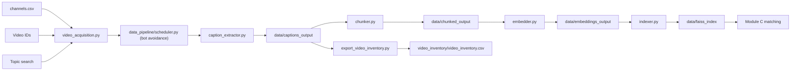

# Module A: Video Acquisition and Indexing

## Purpose

Find maths teaching videos on YouTube, download their transcripts, and turn them into
a searchable local FAISS index that the matching step (Module C) queries.

## Scope

In scope:
- Choosing sources: curated channels and playlists (`channels.csv`), specific video
  IDs, and keyword/title search of YouTube.
- Caption (transcript) extraction with bot-detection avoidance (batches, random
  delays, breaks, stop on IP block, resumable state).
- Chunking transcripts, embedding chunks (OpenAI `text-embedding-3-large`) and
  building the FAISS index.
- Removing videos or channels from every local store (deletion).
- Reporting what is held (video inventory) and exporting a channel's playlists.

Out of scope:
- Teaching-quality scoring. The scorer lives in `data_pipeline/instruction_quality_scorer.py`,
  but it scores a video *against a specific small step*, so it runs during matching
  (see `docs/quality_assurance.md`).
- Checking whether published videos are still available on YouTube (Module C).

## Data flow

## Entry points

Run from the project root.

| Task | Command |
|---|---|
| Acquisition GUI (channels, video IDs, topic search, then chunk/embed/index) | `launch_video_acquisition.bat` |
| Full pipeline from the command line | `python data_pipeline/run_pipeline.py [--extract-only \| --index-only] [--max-videos N] [--rebuild-index]` |
| Delete a video or channel (preview first) | `python acquisition/delete_content.py --video ID --dry-run`, then `--yes --rebuild-index` |
| Delete a batch of videos | `python acquisition/delete_content.py --batch videos_to_delete/videos_to_delete.csv` |
| Check a deletion is complete | `python acquisition/delete_content.py --validate ID` |
| Rebuild the FAISS index only | `python acquisition/delete_content.py --rebuild-index` |
| Export the video inventory | `python acquisition/export_video_inventory.py` |
| Export a channel's playlists | `python acquisition/export_channel_playlists.py CHANNEL_ID --output out.csv` |

## Inputs

- `channels.csv` (project root): channels and playlists to extract from.
- `.env`: `YOUTUBE_API_KEY`, `OPENAI_API_KEY`. Optional: `SMTP_*` and
  `NOTIFICATION_EMAIL` for scheduler alerts.
- Settings in `shared/config.py`: delays, batch size, break lengths, maximum video
  duration (20 minutes), chunk size, embedding model.

## Outputs

All in `data/`, which is local only and not in git:
- `data/captions_output/<channel>/`: raw transcripts and metadata.
- `data/chunked_output/`, `data/embeddings_output/`, `data/embeddings_consolidated.json`.
- `data/faiss_index/`: the FAISS index and `faiss_index_metadata.json`.
- `data/deleted_videos.json`: soft-deleted video IDs, excluded from search.

Also:
- `extraction_state.json` and `search_history.json` (project root): resumable
  extraction state and topic-search history.
- `video_inventory/video_inventory.csv`: one row per held video (channel, title,
  duration). Precompute and the QA GUI read it.
- `_deletion_backups/`, `_deletion_logs/`: automatic backups and logs from deletions.

## Key files

| File | Role |
|---|---|
| `acquisition/video_acquisition.py` | Tkinter GUI (formerly `gui_main.py`) |
| `acquisition/delete_content.py` | Deletion command-line tool |
| `acquisition/export_video_inventory.py` | Inventory report |
| `acquisition/export_channel_playlists.py` | Lists a channel's public playlists, for curating `channels.csv` |
| `data_pipeline/scheduler.py` | Bot-avoidance batching used by the GUI's channel extraction |
| `data_pipeline/caption_extractor.py` | YouTube Data API plus transcript download |
| `data_pipeline/chunker.py`, `embedder.py`, `indexer.py` | Chunk, embed, index |
| `data_pipeline/run_pipeline.py` | Command-line version of the whole pipeline (the QA GUI also calls it for a full FAISS rebuild) |
| `data_pipeline/deletion_manager.py`, `deletion_tracker.py` | Deletion logic and the soft-delete list |
| `shared/config.py` | Paths, keys and tuning constants |

## Status

Stable. Scripts must be run from the project root (the launcher does this), because
data paths are relative to it.

Known issue: `data_pipeline/deletion_manager.py` looks for `video_inventory.csv` in the
project root, but the inventory is written to `video_inventory/video_inventory.csv`.
So deletions do not remove the row from the inventory. Re-run
`export_video_inventory.py` after deleting to refresh it.

## Background / design history

- `docs/_history/acquisition/`: the older deletion guide, the scheduled-extraction
  quickstart and the readability-scoring notes (readability scoring is retired; its
  code is in `_archive/`).
- `_archive/docs/`: earlier GUI, chunking, embedding, FAISS and rate-limiting guides.
