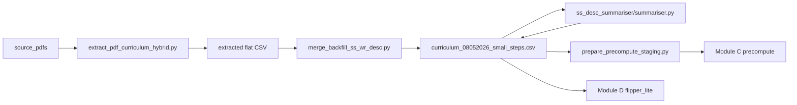

# Module B: Curriculum

## Purpose

Maintain one canonical table of the White Rose Maths curriculum, with one row per
small step, that every other module matches against or displays.

## Scope

In scope:
- Extracting small-step text (`ss_wr_desc`) from the White Rose Scheme of Learning PDFs.
- Merging extracted text into the canonical curriculum CSV, safely and with a preview.
- Generating short teacher-facing descriptions (`ss_desc`) from `ss_wr_desc` with an LLM.
- Preparing a filtered curriculum CSV so only new or changed steps are re-matched.

Out of scope:
- Matching videos to steps (Module C, Matching and QA).
- Hand-editing step text during QA. That is done in the QA GUI and stored in
  `qa/targeted_ss_wr_desc_overrides.csv` and `qa/approved_ss_wr_desc_candidates.csv`.
- Displaying the curriculum (Module D, Delivery).

## Data flow

## Entry points

All commands run from the project root.

| Task | Command |
|---|---|
| Extract a folder of PDFs | `python Curriculum/Maths/pdf_extractor/extract_pdf_curriculum_hybrid.py --folder "Curriculum/source_pdfs/Year 1" --output <out.csv> [--append] [--skip <file.pdf> ...]` |
| Preview a merge into the canonical CSV | `python Curriculum/Maths/pdf_extractor/merge_backfill_ss_wr_desc.py --canonical Curriculum/Maths/curriculum_08052026_small_steps.csv --backfill <flat.csv> --preview <preview.csv> --manual-review <queue.csv>` |
| Apply the merge | the same command plus `--apply --backup <backup.csv>` |
| Generate missing `ss_desc` (LLM) | `python Curriculum/Maths/ss_desc_summariser/summariser.py --mode all [--limit N] [--inplace]` |
| Stage new steps for re-matching | `python Curriculum/Maths/pdf_extractor/prepare_precompute_staging.py` |

## Inputs

- `Curriculum/source_pdfs/Year N/*.pdf`: the White Rose SOL PDFs (about 1.3 GB, not in git).
- `OPENAI_API_KEY` in `.env` (summariser only).

## Outputs

- `Curriculum/Maths/curriculum_08052026_small_steps.csv` is the canonical curriculum.
  Key columns are `small_step_id` and `small_step_key` (stable IDs used everywhere),
  `ss_wr_desc` (White Rose text) and `ss_desc` (short description).
  **Do not move or rename this file.** The deployed app, the precompute script, the
  QA GUI and `flipper_search` all read it at this path.
- `Curriculum/Maths/ss_desc_summariser/curriculum_08052026_small_steps.with_ss_desc_generated.csv`
  is the summariser's merged output when `--inplace` is not used. The thought-prompt
  generator also reads it.
- `Curriculum/Maths/pdf_extractor/curriculum_newdesc_staging.csv` is the staging subset
  for precompute.

## Key files

| File | Role |
|---|---|
| `Curriculum/Maths/curriculum_08052026_small_steps.csv` | Canonical curriculum |
| `Curriculum/Maths/pdf_extractor/extract_pdf_curriculum_hybrid.py` | PDF to flat CSV |
| `Curriculum/Maths/pdf_extractor/merge_backfill_ss_wr_desc.py` | Safe merge into canonical CSV (never overwrites non-empty text unless asked) |
| `Curriculum/Maths/pdf_extractor/prepare_precompute_staging.py` | Selects steps missing from the precomputed recommendations |
| `Curriculum/Maths/ss_desc_summariser/summariser.py` | LLM `ss_desc` generation and merge |
| `shared/curriculum_schema.py` | Shared helpers for step IDs and the long/wide curriculum formats |

## Status

Stable. The canonical CSV covers Years 1 to 11 (1,683 small steps). PDFs for Years 12
and 13 are in `source_pdfs/` but have not been merged in.

Completed one-off fixes (the schema migration, the step-name artifact cleanup, the
March reorganisation in `curr_reorg/`) and their intermediate CSVs are in
`_archive/curriculum/`.

## Background / design history

These describe earlier states and are kept for rationale only:
- `docs/_history/curriculum/PDF_EXTRACTOR_USAGE.md`
- `docs/_history/curriculum/PDF_STRUCTURE_ANALYSIS.md`
- `docs/_history/curriculum/Y7_Y10_summer_backfill_plan.md`
