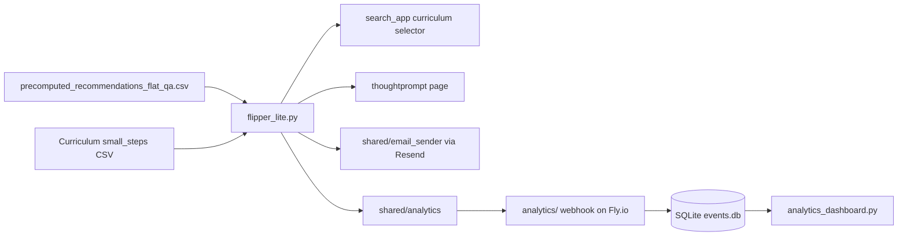

# Module D: Delivery

## Purpose

The public product: a free web app (flipper.school, `flipper_lite.py` on Streamlit
Community Cloud) where teachers, parents and home-schoolers pick a year group, block
and small step and get three reviewed teaching videos, plus the tools that measure
how it is used.

## Scope

In scope:
- `flipper_lite.py` and everything it imports: the curriculum selector, thought
  prompts, email-me-these-videos, landing page and styles.
- Analytics: event tracking in the app, the webhook receiver on Fly.io, and the
  private dashboard.

Out of scope:
- Choosing or reviewing videos (Module C). The app only reads the published CSV and
  makes **no paid API calls** at runtime.

## Data flow

## Entry points

| Task | Command |
|---|---|
| Run the app locally | `.venv\Scripts\streamlit.exe run flipper_lite.py` |
| Deploy the app | Push to GitHub `main`. Streamlit Community Cloud redeploys `flipper_lite.py` and installs `requirements.txt`. |
| Private analytics dashboard | `launch_analytics_dashboard.bat` |
| Deploy the analytics receiver | `cd analytics` then `fly deploy` |
| Regenerate thought prompts (pilot) | `python thoughtprompt/generate_pilot_prompts.py` |
| Rebuild step-search embeddings (only if step search is re-enabled) | `python -m flipper_search.build_index --curriculum Curriculum/Maths/curriculum_08052026_small_steps.csv --output data/curriculum_embeddings.npy` |

## Files the deployed app reads (do not move or rename)

- `flipper_lite.py`, `requirements.txt`, `runtime.txt`, `.streamlit/config.toml`
- `precomputed_recommendations_flat_qa.csv` (preferred) and `precomputed_recommendations_flat.csv` (fallback)
- `Curriculum/Maths/curriculum_08052026_small_steps.csv`
- `shared/` (styles, analytics, email, step selection, schema helpers)
- `search_app/`, `thoughtprompt/` (including `pilot_output/thought_prompts_multiplechoice.csv`), `flipper_search/`
- `static/landing/*.jpg`: landing photos (served because `enableStaticServing = true`)

`tools/smoke_test.py` checks that these still exist.

## Key files

| File | Role |
|---|---|
| `flipper_lite.py` | The app: landing page, selector, video cards, sticky header, email form |
| `search_app/curriculum_assistant.py` | Cascading age, topic and step selector, plus topic-table search |
| `shared/step_selection.py` | Resolves the chosen step and its neighbours (also used by the QA GUI) |
| `thoughtprompt/page.py` | Full-screen "Try Thought Prompt" page: question, visuals, text-to-speech, educator view |
| `thoughtprompt/visual_generator.py`, `number_line.py` | Generated visuals (PIL) and the draggable number line |
| `thoughtprompt/generate_pilot_prompts.py` | Generates the pilot prompts (Year 4 place value) |
| `shared/email_sender.py` | Sends the "email me these videos" message via Resend (no address is stored) |
| `shared/analytics.py` | Event tracking: page views, selections, video opens, UTM and TikTok attribution |
| `shared/styles/flipper_lite.css` | Page styles |
| `flipper_search/` | Natural-language step search. **Currently switched off** (`ENABLE_FLIPPER_SEARCH = False` in `flipper_lite.py`) |
| `analytics/analytics_webhook_server.py` | Dependency-free receiver: `POST /collect`, `GET /events`, `GET /health` |
| `analytics/analytics_dashboard.py` | Password-protected Streamlit dashboard (KPIs, funnel, sources, TikTok campaigns, top videos) |
| `analytics/Dockerfile`, `fly.toml`, `.dockerignore` | Fly.io deployment of the receiver |
| `google_verification/` | Google Search Console site-verification file |

## Secrets

Set the **deployed app's** secrets in share.streamlit.io, under your app, Settings,
then Secrets. Your local `.streamlit/secrets.toml` does not affect the deployed app.

| Name | Used by | Purpose |
|---|---|---|
| `FLIPPER_ANALYTICS_WEBHOOK_URL`, `FLIPPER_ANALYTICS_WEBHOOK_TOKEN` | app | Where to POST events (`https://<fly-app>.fly.dev/collect`) |
| `FLIPPER_ANALYTICS_OWNER_TOKEN` | app | Visits with `?owner=<token>` in the URL are excluded from analytics |
| `FLIPPER_RESEND_API_KEY`, `FLIPPER_EMAIL_FROM`, `FLIPPER_EMAIL_REPLY_TO` | app | Email-me-these-videos |
| `ANALYTICS_TOKEN` | receiver (`fly secrets set`) | Shared token checked on `/collect` and `/events` |
| `ANALYTICS_DASHBOARD_PASSWORD` | dashboard | Password gate |
| `ANALYTICS_REMOTE_URL`, `ANALYTICS_REMOTE_TOKEN` | dashboard (local) | Read events from the receiver over HTTPS |

## Analytics notes

- The deployed app runs on Streamlit's servers with a temporary filesystem.
  `data/analytics/events.jsonl` written there is lost on redeploy or sleep, so real
  traffic only reaches you through the webhook receiver.
- The receiver stores events in SQLite on a persistent Fly volume (`/data/events.db`).
  First-time setup, from `analytics/`: `fly launch --no-deploy`, then
  `fly volumes create analytics_data --size 1`, then `fly secrets set ANALYTICS_TOKEN=...`,
  then `fly deploy`.
- The dashboard reads `ANALYTICS_REMOTE_URL` first. Otherwise it falls back to the
  local `data/analytics/events.db` or `events.jsonl` and shows a warning banner,
  because local files never contain deployed-app traffic.
- If the dashboard shows no real traffic:
  1. Check the secrets are set on the deployed app.
  2. Check the receiver is up: `curl https://<receiver>/health` should return `{"status":"ok"}`.
  3. Look for `[analytics] webhook delivery failed` in the Streamlit Cloud logs.
- TikTok click counts and app sessions differ because of link-preview bots, quick
  bounces and repeat clicks. Tag links so the two can be joined:
  `https://www.flipper.school/?utm_source=tiktok&utm_medium=paid_social&utm_campaign=<name>&ttclid=__CLICK_ID__`

## Status

Live. Tidied in October 2026:
- The Tier 2 live-search app `flipper.py` was abandoned (per-use OpenAI cost) and is
  in `_archive/delivery/`.
- The unused `ux/` widget, the thought-prompt one-off fix and test scripts, the SVG
  experiments and `shared/utils.py` were also archived.
- `requirements.txt` still lists back-end packages (faiss, openai, anthropic and
  others) that the app does not need at runtime. Trimming it would speed up deploys,
  but it changes the live deployment, so test it on a branch first.

## Background / design history

- `docs/SMALL_STEP_PAYLOAD_CONTRACT.md`: the step payload shared by the selector and
  step search (still current; code comments refer to it).
- `docs/_history/delivery/`: thought-prompt design notes and pilot reports,
  flipper_search design notes, the UX subproject brief and spec, mobile UX notes.
