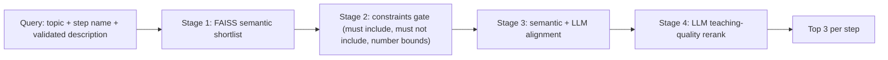
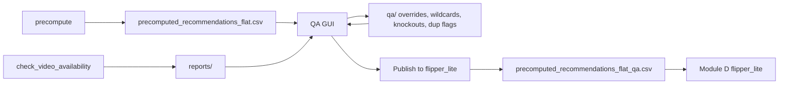

# Module C: Matching and Quality Assurance

## Purpose

For every curriculum small step, choose the three best teaching videos from the FAISS
index, let a human review and correct those picks, and publish the result as the
single CSV that the public app reads.

## Scope

In scope:
- Automatic matching (precompute): semantic search, a constraints gate, LLM
  alignment and teaching-quality scoring, and a final rerank.
- Manual QA in the GUI: rating picks, re-wording the step text and re-searching,
  manual overrides, wildcards, per-step knockouts, duplicate review across adjacent
  steps, and flagging steps as redundant.
- Finding published videos that have been removed by the creator, made private,
  or had embedding disabled, and replacing them.
- Publishing `precomputed_recommendations_flat_qa.csv`.

Out of scope:
- Building or changing the FAISS index (Module A). The GUI can trigger a rebuild,
  but the work is done by `data_pipeline/run_pipeline.py`.
- Changing the canonical curriculum (Module B). QA wording edits are stored as
  overrides in `qa/`, and the canonical CSV is never edited from here.

## How a pick is made

Precompute and the GUI both use the same engine, `shared/pick_engine.py`:

The final score weights are semantic 0.55, alignment 0.20 and teaching quality 0.25.
The teaching-quality scorer (`data_pipeline/instruction_quality_scorer.py`,
`gpt-4o-mini`) rates a video *for a specific step and age*. Results are cached in
`data/instruction_quality_runtime_cache.json`, so each video and step pair is only
paid for once.

## QA workflow

## Entry points

Run from the project root.

| Task | Command |
|---|---|
| QA GUI | `launch_quality_assurance.bat` |
| Precompute all steps (paid API calls; resumes by default) | `python quality_assurance/precompute_curriculum_recommendations.py` |
| Precompute only new steps | Run `Curriculum/Maths/pdf_extractor/prepare_precompute_staging.py` first, then precompute with `--curriculum <staging csv> --output <staging output>` |
| Check published videos are still on YouTube | `check_video_availability.bat`, or the GUI's availability button |

In the GUI, the usual loop is:
1. Pick a step. Filters let you jump to the next unsaved step, a step with low
   ratings, or a step with an unavailable video.
2. Rate the current picks. If they are weak, edit the step wording or the
   constraints and re-search.
3. Override or exclude videos, or add a wildcard.
4. Save the step to `qa.csv`.
5. When finished, choose **Publish to flipper_lite**.

Unavailable videos are highlighted red if deleted or private, and yellow if embedding
is disabled (still watchable on YouTube, but it will not play inside Flipper). Use
**Delete everywhere** to remove a video from all local stores. This runs
`acquisition/delete_content.py`.

## Inputs

- `data/faiss_index/` and `data/instruction_quality_runtime_cache.json` (Module A).
- `Curriculum/Maths/curriculum_08052026_small_steps.csv` (Module B).
- `video_inventory/video_inventory.csv`: channel and duration for display.
- `.env`: `OPENAI_API_KEY` (search and scoring), `YOUTUBE_API_KEY` (availability check).

## Outputs and QA state

| File | Content |
|---|---|
| `precomputed_recommendations_flat.csv` | Automatic picks from precompute (fallback for the app) |
| `precomputed_recommendations_flat_qa.csv` | **Published, reviewed picks read by the app. Do not move.** |
| `qa/qa.csv` | Per-step QA record: ratings, candidate wording, constraints text, saved picks |
| `qa/manual_precomputed_overrides.csv` | Manually chosen picks per step |
| `qa/wildcards/wildcards.csv` | Extra hand-picked videos added to a step (`wildcards_build.ods` is the authoring spreadsheet) |
| `qa/step_video_knockouts.csv` | Videos excluded from one step only |
| `qa/dup_flagged_steps.csv` | Steps flagged as redundant (duplicating a neighbour) and hidden from display |
| `qa/ss_desc_validated_overrides.csv` | Approved step wording that precompute uses in place of the canonical text |
| `qa/targeted_ss_wr_desc_overrides.csv`, `qa/approved_ss_wr_desc_candidates.csv` | Candidate and approved wording edits |
| `qa/logs/` | Command log of jobs the GUI runs (not in git) |
| `reports/*video_availability_check.csv` | Availability check results |

## Key files

| File | Role |
|---|---|
| `quality_assurance/quality_assurance.py` | QA GUI (formerly `Improve_pick/gui_precompute_recommendation_qa.py`) |
| `quality_assurance/precompute_curriculum_recommendations.py` | Batch matching for all steps |
| `quality_assurance/check_video_availability.py` | YouTube Data API status check (deleted, private, embedding disabled) |
| `shared/pick_engine.py` | The shared four-stage pick pipeline |
| `query_embedder.py` | Embeds query text (also used by `flipper_search`) |
| `data_pipeline/instruction_quality_scorer.py` | LLM teaching-quality and alignment scoring |

## Duplicate review

The Adjacent Steps tab ranks steps by how often they share videos with nearby steps.
The score combines distance-weighted proximity, a context z-score and the local
probability that a duplicate is within 3 steps, shrunk for low evidence. Settings:
`DUP_REVIEW_W` and `DUP_REVIEW_K_SHRINK` at the top of `quality_assurance.py`. The
equations are in `docs/_history/qa/dup_stat.md`.

## Status

Stable. Tidied in October 2026: the retrieval experiments (query comparator, targeted batch QA runs, the old constraints
gate CSVs, the exception registry) are in `_archive/qa/`.

## Background / design history

These describe earlier states and are kept for rationale only:
- `docs/_history/qa/improve_pick_readme.md`: why the GUI pipeline beat the original
  batch precompute (April 2026). That gap has since been closed by `shared/pick_engine.py`.
- `docs/_history/qa/INSTRUCTION_QUALITY_USAGE.md`: the retired generic batch scorer.
- `docs/_history/qa/unavailable_video_workflow.md`, `video_availability_checker.md`,
  `EMBEDDING_DISABLED_EXPLAINED.md`: the original notes on availability checking.
- `docs/_history/qa/dup_stat.md`: duplicate-score equations.
